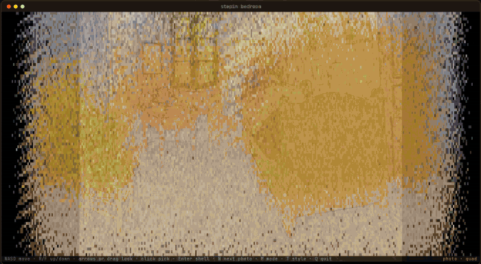

# stepin

Walk around inside a photo, in your terminal.



## Install

You need Linux (or WSL), Python 3.11-3.13 and [uv](https://docs.astral.sh/uv/). An NVIDIA card with 8 GB or so helps a lot.

```
git clone https://github.com/EmilSuuronen/stepin
cd stepin
uv sync
```

## Use

```
uv run stepin               # living room
uv run stepin bedroom       # one of the built-in photos
uv run stepin my-photo.jpg  # your own
```

Built in: `bedroom` `bicycle` `cafe` `desk` `dog` `kitchen` `livingroom` `palace` `village`

The AI models (about 5 GB) download the first time you run it. A new photo takes around a minute, after that it opens right away. Nothing gets uploaded anywhere.

Make the terminal window big. Small font = better picture.

## Keys

| | |
| --- | --- |
| `W A S D` | move |
| `R` `F` | up, down |
| arrows / drag | look |
| click | what's this? |
| `N` | next photo |
| `M` | drawing mode |
| `T` | style |
| `L` | name tags |
| `Home` | back to the start |
| `Enter` | open the shell, and close it on an empty line |
| `Q` | quit |

## Shell

```
ls                    what's here
cd sofa               fly to it
rm chair              remove it and paint in what was behind
mv chair left 1.2     move it (metres)
cp chair              another one
find red mug          look for anything
measure chair table   how far apart
undo                  oops
open cafe             another photo
snap                  save a picture
help                  the rest
```

## Good to know

- A photo only shows one side of things, so go too far and you'll see gaps.
- Sizes are estimates.
- Changes are gone when you quit.
- Garbled picture? Try `--mode half`.

## Built with

[MoGe-2](https://github.com/microsoft/MoGe), [SAM 2.1](https://github.com/facebookresearch/sam2), [Florence-2](https://huggingface.co/florence-community/Florence-2-large), [Grounding DINO](https://github.com/IDEA-Research/GroundingDINO), [LaMa](https://github.com/advimman/lama), Numba.

Photo credits are [here](src/stepin/photos/CREDITS.md).
